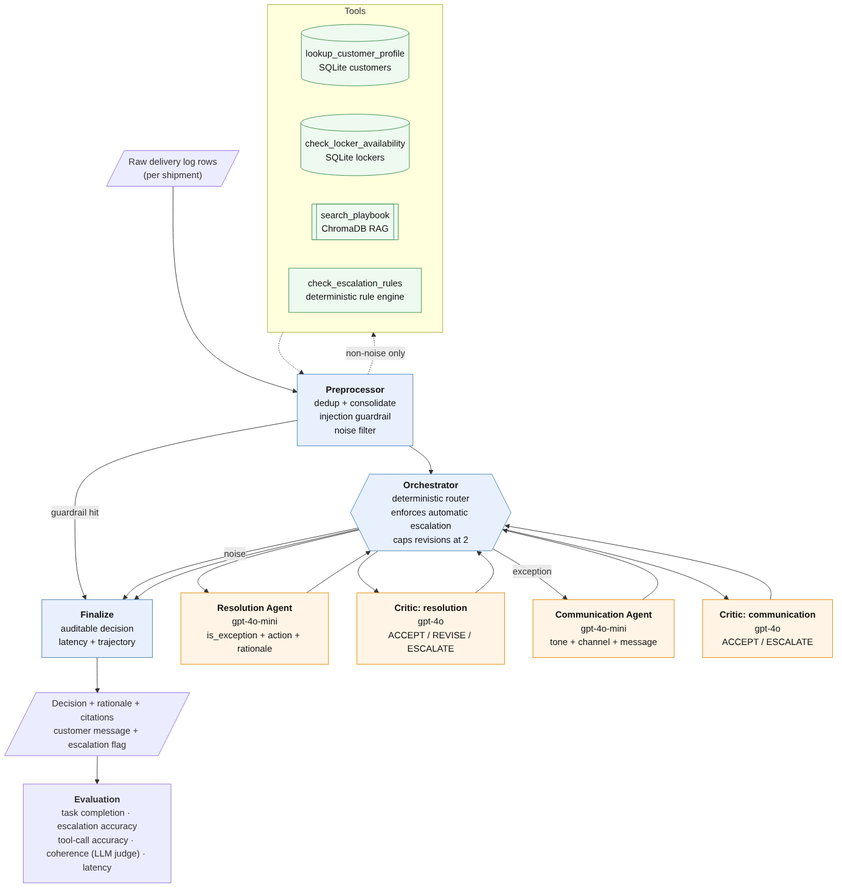

# AI Agents for Automation — Last-Mile Delivery Exception Handling (Multi-Agent Systems)

**Stack:** Python, LangGraph, LangChain, OpenAI (gpt-4o-mini / gpt-4o / text-embedding-3-small), ChromaDB, Pydantic, SQLite, pandas, matplotlib

## Goal
Automate the exception-handling desk of a mid-sized retailer's last-mile operation. Roughly 10% of shipments fail on
the first try — nobody home, address not found, damaged box, refused, weather — and each one is triaged by hand today:
read the driver's note, look up the customer, check the playbook, decide, write to the customer, and know when to pull
in a supervisor. The system has to do all of that from the operator's own data, correctly separate real exceptions
from routine scan noise, and produce an auditable decision every time.

## Approach
A **hub-and-spoke multi-agent graph** built with LangGraph. Deterministic code does everything that policy makes
exact; LLM agents handle only the judgment calls, and a separate Critic model checks them.

| Component | Type | Responsibility |
|:--|:--|:--|
| Preprocessor | deterministic | De-duplicates repeated scans, consolidates multi-row shipments on the highest attempt (earlier driver notes preserved), runs a prompt-injection guardrail, short-circuits routine `DELIVERED`/`SCANNED` rows with zero tool or LLM calls |
| Five tools | code + RAG | Customer lookup with a PII flag (only the Communication Agent sees the name), locker eligibility (size / capacity / FULL / LIMITED rules), delivery-log reader, playbook retrieval from a ChromaDB index with page citations, and a rule engine encoding the playbook's Escalation Matrix |
| Orchestrator | deterministic router | Fixed-priority routing, a two-loop revision cap, and **hard enforcement of automatic escalation triggers** — an LLM cannot talk its way out of a mandatory escalation |
| Resolution Agent | gpt-4o-mini | Exception vs noise, then exactly one of RESCHEDULE / REROUTE_TO_LOCKER / REPLACE / RETURN_TO_SENDER with a numbered, page-cited rationale; Pydantic schema with a cross-field consistency validator and retries |
| Critic (resolution) | gpt-4o | ACCEPT / REVISE (feedback loops back) / ESCALATE; honours the playbook's *discretionary* triggers — the "use your judgment" cases |
| Communication Agent | gpt-4o-mini | Customer notification with tone from tier (VIP/Premium formal, Standard casual), format from channel (email vs SMS), locker details when rerouting, severity-scaled apology, no internal jargon |
| Critic (communication) | gpt-4o | Tone, consistency with the resolution, fabricated promises, channel fit |

The playbook PDF extracts one word per line with `pypdf`, so whitespace is normalised before chunking (700 chars /
120 overlap, ~30 chunks). Retrieval uses a topic hint per status code plus a second lookup against the escalation
matrix, so the agents always see the situation-specific rule *and* the escalation rule.

**Evaluation** runs every shipment through the compiled graph and scores five dimensions against ground truth: task
completion (exception + resolution + tone all correct), escalation accuracy, tool-call accuracy for the path taken,
reasoning-trajectory coherence (LLM-as-a-judge, 1–5), and end-to-end latency. Each test case prints the consolidated
event, tool-call log, trajectory, both critic rationales, playbook page citations, the customer message, and an
observations block generated from the run itself so the narrative can never contradict the output.

## Results
Ten curated shipments: 8 exceptions, 2 routine rows, 2 duplicate scans, 3 multi-row shipments.

| Metric | Result |
|:--|:--|
| Task completion rate | **100%** (10/10) |
| Escalation accuracy | **100%** — 6 escalations raised, 2 routine cases correctly left alone |
| Tool-call accuracy | **100%** |
| Reasoning trajectory coherence | **5.0 / 5** |
| Latency | ~8.5 s per shipment; noise rows 0.001 s with zero LLM calls |
| Critic revision loops | 0 |

- **The hardest case worked for the right reason.** SHP-005 is a third failed attempt where the only locker in the
  zip is FULL. A rigid rule engine would conclude "locker impossible" and schedule a fourth attempt — which the
  playbook forbids. The agent kept REROUTE_TO_LOCKER as the recommendation and escalated with an explicit ask for the
  supervisor to authorise an alternative locker, which is the playbook's own model of a good escalation
- **Discretionary escalation is where the LLM earns its place.** SHP-008 (Standard customer, second attempt, six
  exceptions in 90 days) has no automatic trigger; the Critic escalated on the playbook's "something is systematically
  wrong" clause, citing the page. The two control cases with no triggers were not escalated
- **Cost scales with exceptions, not events.** The two noise rows cost nothing; the eight exceptions used 32 LLM calls
  and ~57k tokens in total
- **Prompt calibration mattered more than architecture.** Earlier runs over-escalated one routine case because the
  Critic sent a *correct* decision back twice on wording grounds and the revision cap then forced an escalation, and
  two customer messages leaked internals ("Given your VIP status", "the locker is currently full"). Each was fixed by
  stating explicitly what REVISE is for and what a customer may never be told — documented in the notebook
- **Honest residual:** one email for a weather-delayed perishable refers to "the damaged item". The communication
  Critic accepted it because tone, resolution and apology were right. The notebook calls this out as an argument for
  a fact-consistency check on message wording and for the pilot mode recommended below

## Business recommendations
Pilot as a **recommend-and-draft assistant** with one-click dispatcher approval, auto-executing only categories with
consistently high agreement; keep the rule engine as the reviewable system of record for policy thresholds; treat the
playbook as executable — the agents cite its pages, so gaps show up as weak rationales; measure resolution time,
escalation precision, truck rolls avoided and spoilage prevented against the manual baseline; add missing status
codes, live scan feeds and a `tone_preference` field before multi-region rollout; and log every supervisor override as
a labelled example so the five metrics become the production monitoring dashboard.

## Files
- [`Delivery_Exception_Agents.ipynb`](Delivery_Exception_Agents.ipynb) — full notebook with outputs (69 code cells, executed sequentially)
- [`Delivery_Exception_Agents_Full_Code.html`](Delivery_Exception_Agents_Full_Code.html) — rendered full-code export
- [`architecture.png`](architecture.png) — system diagram

*Credentials are loaded from a local `config.json` that is git-ignored and not part of this repository. The delivery
logs, customer database, ground truth and operations playbook are course materials distributed by Great Learning /
UT Austin McCombs and are not redistributed here.*
